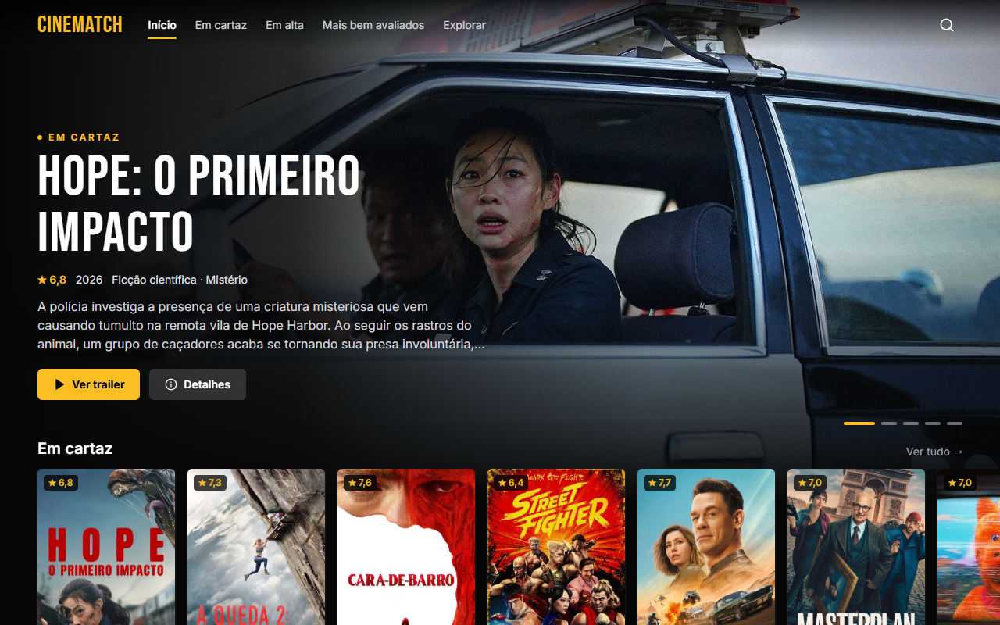
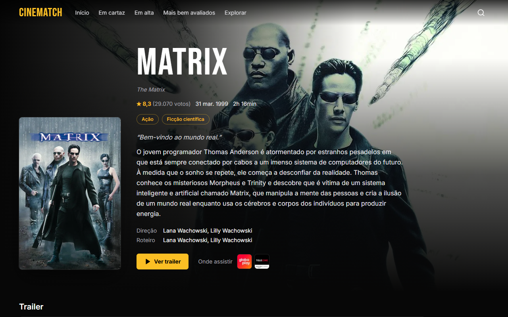
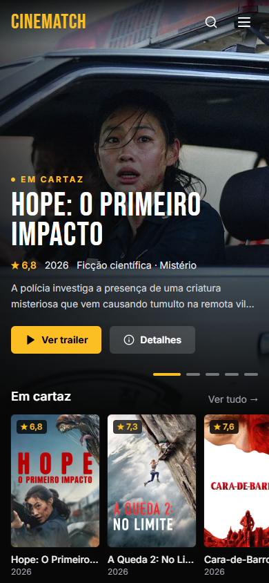

# 🎬 CineMatch

Descubra o que assistir: filmes em cartaz, em alta e mais bem avaliados, com trailer, elenco, direção e onde assistir — numa interface escura de sala de cinema, feita para o celular e para telas grandes.

> 🔗 **[cinematch.jteixeira.dev](https://cinematch.jteixeira.dev)**



---

## 🌟 Destaques

- **Destaque em carrossel** com a imagem do filme ocupando a tela, título de cartaz, nota, gêneros e sinopse; troca sozinho e pausa no mouse/foco.
- **Fileiras horizontais** (Em cartaz, Em alta, Mais bem avaliados) com rolagem por arraste ou setas.
- **Busca com sugestões** na navbar (atalho `/`) e página de resultados com o termo na URL.
- **Explorar** por gênero e ordenação, com scroll infinito.
- **Página do filme** com fundo do próprio filme, trailer (cai para o original em inglês quando não há dublado), elenco, direção, roteiro, onde assistir e recomendados.
- **Dados em pt-BR**: `★ 7,6`, `19 out. 2026`, `1h 52min`.
- **Chave da API protegida**: o navegador nunca fala com o TMDb — tudo passa por uma função na Vercel.

## 🔐 Como a chave fica protegida

```
navegador ──► /api/tmdb/movie/popular ──► função Vercel (api/tmdb.ts) ──► api.themoviedb.org
                                          + api_key (env TMDB_API_KEY)
                                          + lista de caminhos permitidos
                                          + cache na CDN (1h, stale 24h)
```

- `api/_tmdb.ts` só aceita os caminhos que o site usa (`movie/…`, `search/movie`, `discover/movie`, `genre/movie/list`); qualquer outro recebe **403**.
- O mesmo código atende `/api/tmdb` no `npm run dev` e no `vite preview` (plugin no `vite.config.ts`), então dev e produção se comportam igual.
- `vercel.json` também resolve os links diretos (`/filme/123`) para a SPA.

## 🛠️ Tecnologias

| Tecnologia | Uso |
| --- | --- |
| **Vue 3 + TypeScript** | Interface e tipagem |
| **Vue Router** | Rotas e links compartilháveis |
| **Tailwind CSS** | Identidade visual "Sala escura" (preto + âmbar, Bebas Neue + Inter) |
| **VueUse** | Debounce, scroll, intervalos |
| **Vercel Functions** | Proxy do TMDb com a chave no servidor |
| **Vitest** | Testes da formatação, paginação, proxy e regras da página do filme |
| **TMDb API** | Dados dos filmes |

## 📷 Telas

| Filme | Celular |
| --- | --- |
|  |  |

## 📌 Rodando localmente

```bash
git clone https://github.com/jpst-dev/cinematch.git
cd cinematch
npm install

# .env (não vai para o git)
TMDB_API_KEY=sua_chave_do_tmdb

npm run dev     # http://localhost:5173
npm test        # testes
npm run build   # type-check + build
```

Na Vercel, cadastre `TMDB_API_KEY` nas variáveis de ambiente do projeto.

---

Feito por [João Teixeira](https://jteixeira.dev). Este produto usa a API do TMDb, mas não é endossado ou certificado pelo TMDb.
